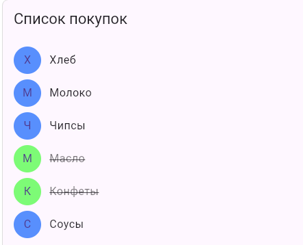

# Заголовок и описание

Список покупок, своя тема,
пользователь должен нажимать на покупки что бы отмечать их.

# Автор

Бухарев, Ярослав, 12.10.2026.

# Стек и версии

flutter -- 3.47.1
Dart -- 3.13.1
Платформа:Web(Edge)
IDE:VS Code

# Скриншот приложения

# Структура проекта

main - основной код с бэкграундом, текстом и кнопками

# Как запустить

git clone <>
cd <my_app_buharev>
flutter pub get
flutter run -d edge

# Что изучили

я узнал как делать кнопки и красить их а также как зачеркивать текст

# Ответы на вопросы

см ниже
